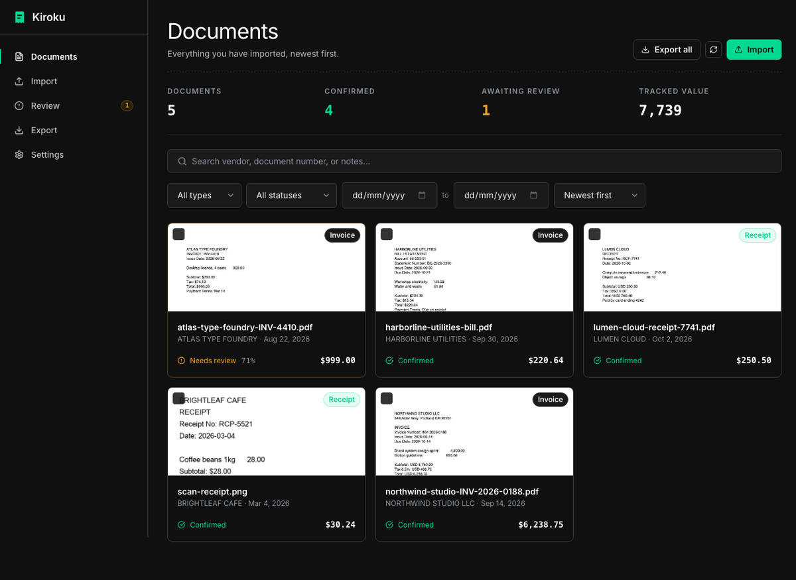

# Kiroku

Kiroku (記録, "records") turns a folder of invoices, receipts, and bills into a
searchable, exportable set of financial records. It reads the vendor, dates, amounts,
and tax off each document, flags anything it is unsure about, and exports a CSV your
accountant can use.

**It runs entirely in your browser.** Documents are parsed, extracted, and stored in
the tab — nothing is uploaded to a server. There is also a self-hosted backend if you
would rather keep everything in a SQLite file on disk.




## Use it

Open the deployed app, or run the frontend yourself:

```bash
cd frontend
npm install
npm run dev        # http://localhost:5173
```

`/` is the landing page and `/documents` is the app. Nothing else is required — no
Python, no database, no API keys.

## How it works

| Step | In the browser |
|---|---|
| Read a PDF | `pdf.js` reads the text layer |
| Read a scan or photo | `tesseract.js` runs OCR (WASM, downloaded on first use) |
| Find the fields | labelled-regex extraction with a confidence score per field |
| Spot duplicates | SHA-256 via Web Crypto, plus vendor + amount + date matching |
| Store | IndexedDB, in your browser's own storage |
| Export | CSV generated client-side |

A document whose total cannot be read, or whose subtotal and tax do not reconcile
with the total, goes to the review queue instead of being confirmed. Kiroku never
invents a value it could not read — missing fields stay empty.

## Back up your data

Browser storage is erased by "clear site data", a private window, or a browser reset.
**Settings → Storage → Download backup** writes one JSON file with every document and
its original; **Restore** reads it back. Do this regularly if these records matter.

## Self-hosting (optional)

The repository also contains a Python backend — FastAPI, SQLite, pdfplumber, and
Tesseract — for keeping records in ordinary files on disk you can back up with normal
tools. It is not needed to use Kiroku.

```bash
python3 -m venv venv && source venv/bin/activate
pip install -r backend/requirements.txt    # Tesseract and Poppler for scans
cd frontend && npm install && npm run build && cd ..
python run.py                              # http://127.0.0.1:8000
```

To point a deployed frontend at a backend instead of the browser engine, build with
`VITE_API_BASE=https://your-backend/api`. Leave it unset and everything stays local.

| Variable | Where | Purpose |
|---|---|---|
| `VITE_API_BASE` | frontend build | Use a backend instead of browser storage |
| `KIROKU_DATA_DIR` | backend | Where documents and the database live |
| `KIROKU_CORS_ORIGINS` | backend | Comma-separated origins allowed to call the API |
| `KIROKU_DISABLE_ML` | backend | Set to `1` to skip the optional classifier model |

## Deploying

The frontend is a static build. On Vercel, set the project's **root directory to
`frontend`** — `vercel.json` lives there and rewrites `/` to the landing page and all
other routes to the app.

## Development

```bash
npm run check    # extractor parity checks
npm run lint
npm run build
```

The extraction rules exist twice — `frontend/src/services/extract.ts` and
`backend/src/ai/extractor.py` — because either can run them. Both ship self-checks
over the same cases; change one and update the other.

## Licence

MIT. See [LICENSE](LICENSE). Threat model in [docs/SECURITY.md](docs/SECURITY.md),
design notes in [docs/ARCHITECTURE.md](docs/ARCHITECTURE.md).
